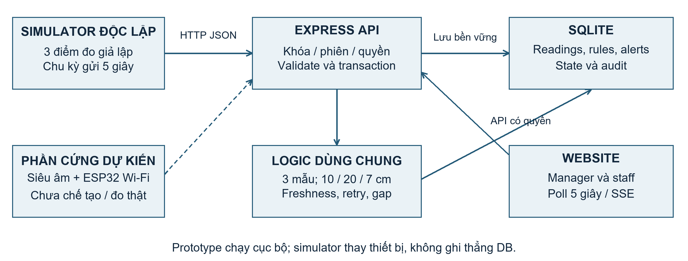
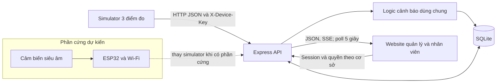
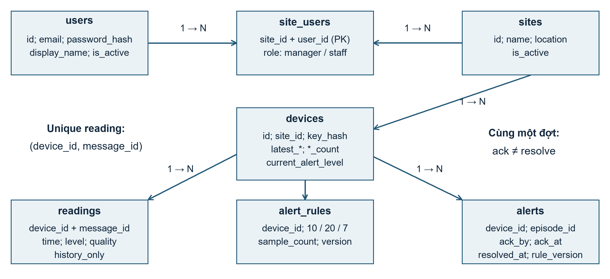
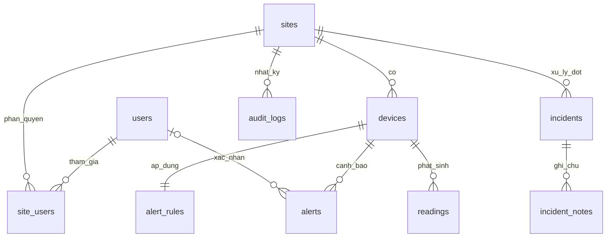
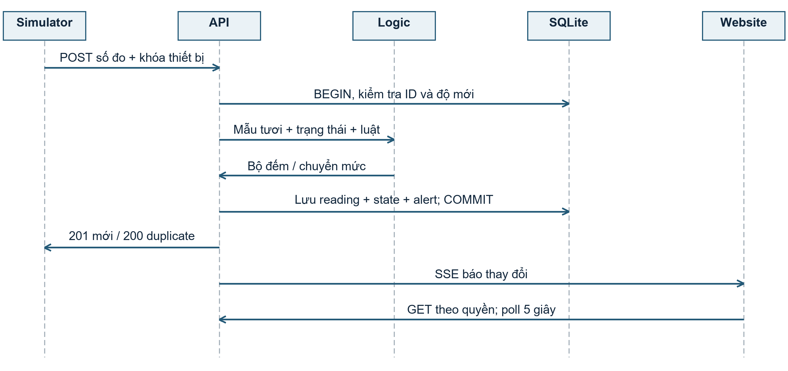
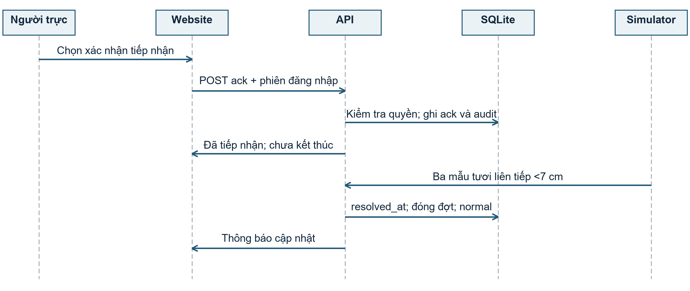
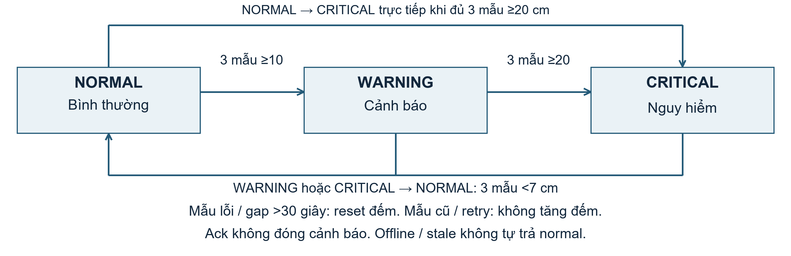
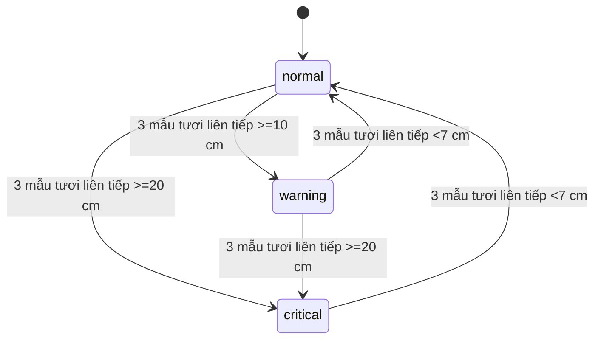

# Kiến trúc hệ thống IoT giám sát mực nước bãi giữ xe

Phạm vi là một bãi xe, ba điểm đo giả lập, web tiếng Việt và backend cục bộ. Chọn Hướng 2: thiết kế sản phẩm IoT. SQLite là DB thực tế; PostgreSQL trong đặc tả cũ không phải công nghệ đang chạy.

## Thành phần và ranh giới

| Thành phần | Nhiệm vụ | Trạng thái |
|---|---|---|
| Cảm biến siêu âm, ESP32, nguồn, hộp bảo vệ | Đo khoảng cách, đổi sang mực nước, gửi Wi-Fi | Thiết kế giả định, chưa chế tạo/hiệu chuẩn |
| Simulator độc lập | Sinh số đo ba điểm, gửi HTTP API thật | Thay thiết bị trong prototype |
| Express API | Xác thực, validate, phân quyền, điều phối giao dịch | Phần mềm |
| Logic cảnh báo dùng chung | Ba mẫu liên tiếp, mở/nâng/đóng đợt, gián đoạn | Phần mềm |
| SQLite | Lưu người dùng, số đo, luật, cảnh báo, nhật ký | DB bền vững trên máy backend |
| Website HTML/CSS/JavaScript | Tổng quan, lịch sử, cảnh báo, quản trị | API; poll 5 giây và SSE thông báo thay đổi |





Server và DB đang chạy cục bộ; cloud là phương án tương lai. SSE chỉ báo có thay đổi; API vẫn kiểm tra quyền khi đọc dữ liệu. Simulator không ghi thẳng DB.

## Cấu tạo và nguyên lý dự kiến

Đầu dò siêu âm đặt cố định cao **H=100 cm** so với mốc đáy. Khoảng cách đến mặt nước là `d`; mực nước `h=H-d`. Miền giả định `10≤d≤100 cm` tương ứng `0≤h≤90 cm`. Đây là thiết kế minh họa, chưa có kết quả đo sai số hay chứng nhận môi trường. Đầu dò, ESP32 có Wi-Fi, nguồn DC, hộp chống nước và giá đỡ là cấu tạo đề xuất.

Thiết bị dự kiến đo/gửi mỗi 5 giây. Cần khảo sát vùng mù, mặt nước gợn, hơi ẩm, vật cản, vị trí lắp và đối chiếu thước đo trước thực địa. Lỗi cảm biến phải có `quality=sensor_error, level_cm=null`, không biến lỗi thành 0. Prototype hiện gửi `level_cm` giả lập, chưa đọc cảm biến thật.

## Mô hình dữ liệu





`readings` unique `(device_id,message_id)`; cùng mã/cùng payload là retry, khác payload là xung đột. `devices` giữ trạng thái và bộ đếm; `alert_rules` có version. `alerts.episode_id` gộp các mức cùng đợt; `ack_at/ack_by` độc lập `resolved_at`. `incidents` và notes hỗ trợ công việc; hoàn tất công việc không tự xóa tình trạng mực nước nguy hiểm.

## Sequence nhận số đo



```mermaid
sequenceDiagram
  participant S as Simulator
  participant A as API
  participant L as Logic cảnh báo
  participant D as SQLite
  participant W as Website
  S->>A: POST telemetry + khóa
  A->>A: Xác thực, validate schema/time
  A->>D: BEGIN và kiểm tra message_id
  alt Mẫu mới đủ tươi
    A->>L: Trạng thái, luật, số đo
    L-->>A: Bộ đếm và chuyển mức
    A->>D: Lưu reading, state, alerts
  else Quá 15 giây hoặc không mới hơn hiện trạng
    A->>D: Lưu history_only, giữ state
  end
  A->>D: COMMIT
  A-->>S: 201; retry tương đương 200
  A-->>W: SSE báo thay đổi
  W->>A: GET dữ liệu theo quyền; poll 5 giây
  A-->>W: JSON cập nhật
```

## Sequence xác nhận và kết thúc



```mermaid
sequenceDiagram
  actor U as Nhân viên hoặc quản lý
  participant W as Website
  participant A as API
  participant D as SQLite
  participant S as Simulator
  U->>W: Xác nhận đã tiếp nhận
  W->>A: POST alerts/:id/ack + phiên
  A->>D: Kiểm tra thành viên cơ sở
  A->>D: Ghi ack_by, ack_at và audit
  A-->>W: Thành công; chưa resolve
  loop Ba mẫu tươi liên tiếp dưới 7 cm
    S->>A: POST telemetry
    A->>D: Lưu mẫu, tăng clear_count
  end
  A->>D: Đóng đợt; resolved_at; normal
  A-->>W: Thông báo cập nhật
```

## Trạng thái cảnh báo và độ mới





Ba bộ đếm độc lập; mẫu ≥20 cũng thỏa ≥10 nhưng ưu tiên critical khi cùng đủ điều kiện. Mẫu không thỏa đặt bộ đếm tương ứng về 0. Không tự hạ critical xuống warning. Sensor_error và khoảng trống giữa mẫu tươi >30 giây ngắt chuỗi. Mẫu cũ/trùng không tăng bộ đếm. Đổi luật reset đếm và tăng version. Ack chỉ ghi tiếp nhận, không đóng cảnh báo.

`data_status` (online/offline/stale/sensor_error/no_data/disabled) tách `current_alert_level` (normal/warning/critical). Offline khi >30 giây không nhận bản tin hợp lệ; stale khi vẫn nhận bản tin nhưng không có dữ liệu tươi. Mất mạng không chứng minh nước đã rút: giữ cảnh báo và hiển thị độ mới.

SQLite phù hợp demo một máy, ba điểm đo; ghi cần tuần tự, unique và rollback. Khi tăng quy mô phải đo tải trước khi chọn hàng đợi/DB máy chủ. Không có phần cứng thật, SMS/email, điều khiển bơm hay dự báo trong phạm vi nghiệm thu.

## Vị trí triển khai trong mã nguồn

`backend/src/routes/telemetry.js` chứa validate và `ingestReading`, là luồng nhận/ghi/cảnh báo dùng chung. `backend/src/routes/devices.js` gọi cùng hàm khi người quản lý tạo một mẫu demo; không dùng một thuật toán ngưỡng riêng. `backend/src/db/index.js` cung cấp truy cập SQLite và bảo vệ giao dịch. `backend/src/routes/sites.js` tính trạng thái dữ liệu từ timestamp; `frontend/js/api.js` và `frontend/js/app.js` tải, hiển thị theo quyền. `simulator/src/index.js` là tiến trình gửi HTTP độc lập.

Trong mô hình dữ liệu, các ID dùng TEXT; level_cm/ngưỡng dùng số cm; thời gian lưu UTC, hiển thị theo múi giờ của trình duyệt; quality và trạng thái là giá trị giới hạn. `history_only` là cờ Boolean lưu bằng integer trong SQLite. Phiên bản luật là số nguyên tăng dần. Khóa và mật khẩu chỉ lưu hash; không phải trường dữ liệu cung cấp cho dashboard.
